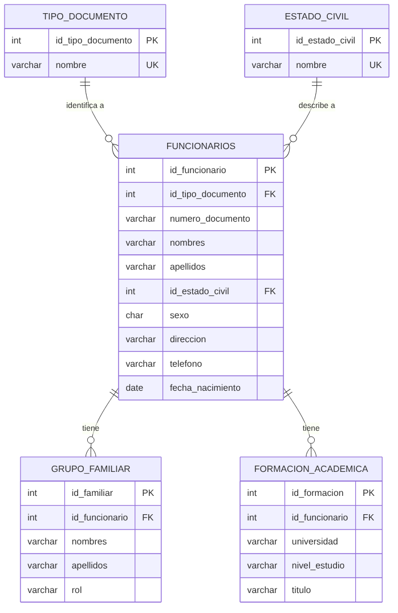

# Modelo relacional · CRUD de funcionarios

Caso de estudio: área de Recursos Humanos de la IU Digital de Antioquia.

## Tablas

| Tabla | Tipo | Qué guarda |
|---|---|---|
| `tipo_documento` | Catálogo | Cédula de ciudadanía, cédula de extranjería, pasaporte, tarjeta de identidad |
| `estado_civil` | Catálogo | Soltero(a), casado(a), unión libre, divorciado(a), viudo(a) |
| `funcionarios` | Principal | Datos personales del funcionario (la tabla del CRUD) |
| `grupo_familiar` | Hija | Cada miembro del grupo familiar del funcionario y su rol |
| `formacion_academica` | Hija | Universidad, nivel de estudio y título de cada estudio del funcionario |

## Relaciones (todas uno a muchos)

| Relación | Se lee | Clave foránea | Al eliminar el "uno" |
|---|---|---|---|
| `tipo_documento` → `funcionarios` | Un tipo de documento identifica a muchos funcionarios | `funcionarios.id_tipo_documento` | Se rechaza (no se borra un tipo en uso) |
| `estado_civil` → `funcionarios` | Un estado civil describe a muchos funcionarios | `funcionarios.id_estado_civil` | Se rechaza |
| `funcionarios` → `grupo_familiar` | Un funcionario tiene muchos familiares | `grupo_familiar.id_funcionario` | `ON DELETE CASCADE`: se borran sus familiares |
| `funcionarios` → `formacion_academica` | Un funcionario tiene muchos estudios | `formacion_academica.id_funcionario` | `ON DELETE CASCADE`: se borran sus estudios |

La clave foránea siempre va en la tabla del lado "muchos".

## Reglas de integridad

- `numero_documento` es texto (`VARCHAR(20)`): un documento puede tener ceros iniciales o letras (pasaporte).
- `uq_funcionario_documento`: no puede haber dos funcionarios con el mismo tipo **y** número de documento.
- `sexo` solo acepta `'M'` o `'F'` (`CHECK`).
- Los nombres de los catálogos son únicos (`UNIQUE`).

Fuente del diagrama: [`modelo.mmd`](modelo.mmd) (Mermaid).
